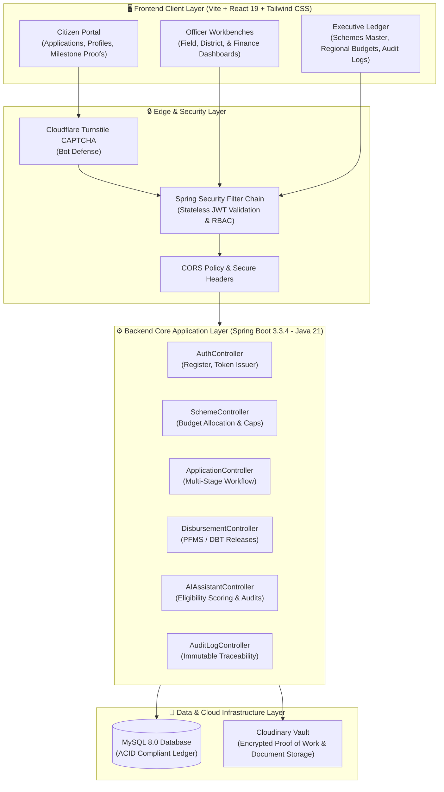
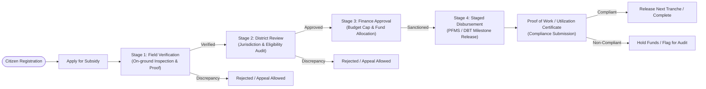
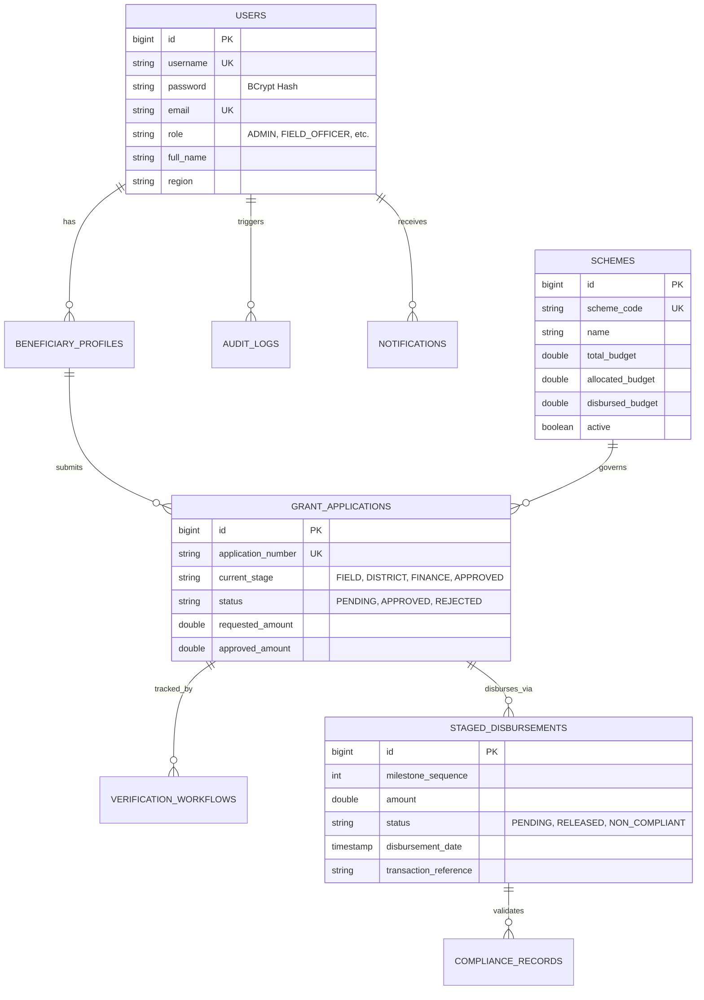

# 🏛️ Digital Subsidy and Grant Management System

<div align="center">

[](https://openjdk.org/projects/jdk/21/)
[](https://spring.io/projects/spring-boot)
[](https://react.dev/)
[](https://vitejs.dev/)
[](https://www.mysql.com/)
[](https://tailwindcss.com/)
[](https://www.cloudflare.com/products/turnstile/)
[](https://railway.app/)
[](https://vercel.com/)

<p align="center">
  <b>An enterprise-grade, transparent public sector platform for subsidy lifecycle governance, multi-tier verification workflows, milestone-based direct benefit transfer (DBT/PFMS), and real-time fund utilization auditing.</b>
</p>

</div>

---

## 📑 Table of Contents
- [Executive Overview](#-executive-overview)
- [System Architecture](#-system-architecture)
- [End-to-End Governance Workflow](#-end-to-end-governance-workflow)
- [Database Entity Relationship Model](#-database-entity-relationship-model)
- [Role-Based Access Control (RBAC)](#-role-based-access-control-rbac)
- [Core Functional Modules](#-core-functional-modules)
- [Zero-Secret Cloud Configuration Architecture](#-zero-secret-cloud-configuration-architecture)
- [Demo Credentials](#-demo-credentials)
- [Local Development Setup](#-local-development-setup)
- [Production Deployment Guide](#-production-deployment-guide)
- [REST API Reference](#-rest-api-reference)
- [Security & Compliance Highlights](#-security--compliance-highlights)

---

## 📌 Executive Overview

The **Digital Subsidy and Grant Management System** addresses critical challenges in public fund distribution: bureaucratic delays, lack of milestone accountability, ghost beneficiaries, and fund leakages. 

Engineered with **Spring Boot 3 (Java 21)** and **React 19**, the platform establishes a transparent, multi-tiered pipeline:
1. **Citizen Ingestion**: Fraud-resistant citizen onboarding with Cloudflare Turnstile bot verification and encrypted document vaulting.
2. **Three-Tier Governance Pipeline**: Strict separation of duties among Field Officers, District Reviewers, and Finance Approvers.
3. **Direct Benefit Transfer (DBT/PFMS)**: Staged disbursement release linked to physical verification and Utilization Certificates (UC).
4. **Real-time Operations Ledger**: Dynamic regional budget tracking, scheme cap enforcement, and immutable audit logs.

---

## 🏗️ System Architecture



---

## 🔄 End-to-End Governance Workflow



---

## 🗄️ Database Entity Relationship Model



---

## 👥 Role-Based Access Control (RBAC)

The application enforces strict separation of privileges across 5 dedicated roles:

| Role | Target Persona | Key Capabilities & Permissions |
| :--- | :--- | :--- |
| **`BENEFICIARY`** | Citizens / Farmers / Students | Register account, build Aadhaar-linked profile, submit scheme applications, track live verification stages, submit Utilization Certificates (UC) and milestone proofs, raise appeals. |
| **`FIELD_OFFICER`** | Ground Inspection Teams | Access regional field verification queue, review submitted proofs of land/income, perform on-site audits, record inspection findings, advance or reject stage 1. |
| **`DISTRICT_OFFICER`** | District Administrative Authorities | Conduct district-wide compliance checks, cross-verify field reports, check regional budget quotas, escalate or approve for financial release. |
| **`FINANCE_APPROVER`** | Treasury & Accounts Officers | Inspect sanctioned grant pools, trigger Direct Benefit Transfer (DBT/PFMS) transactions, verify banking references, release staged tranches. |
| **`ADMIN`** | System & Policy Executives | Manage Master Schemes (Central/State), adjust regional budget ceilings, view system-wide analytics, monitor tamper-evident audit logs, provision officer accounts. |

---

## ⚡ Core Functional Modules

### 1. 🛡️ Bot Defense & Authentication
- **Cloudflare Turnstile CAPTCHA**: Native zero-friction protection shielding authentication endpoints from automated credential stuffing.
- **Stateless JWT**: Standard RFC 7519 HMAC-SHA signing with 24-hour expiration and instantaneous role authorization.

### 2. 📋 Schemes Master & Regional Budget Ceilings
- Central and State sector scheme catalog with dynamic budget limits.
- Automatic regional ceiling tracking (North, South, East, West) preventing over-allocation of public funds.

### 3. 💸 Milestone-Based Staged Disbursements
- Replaces lump-sum payouts with tranche-based fund releases.
- Tranches remain locked until the beneficiary uploads geo-tagged proof and Utilization Certificates (UCs) verified by ground officers.

### 4. 🤖 AI-Assisted Recommendation & Fraud Scoring
- Automated heuristic analysis of applications evaluating income tiers, category matching, and historical rejection patterns to flag suspicious requests early.

### 5. 📜 Immutable Audit Trails & Notification Engine
- Audit trail recording IP address, actor ID, action type, and state diff for every lifecycle decision.
- In-app notification center notifying citizens of stage transitions, queries, and disbursement settlements.

---

## 🔐 Zero-Secret Cloud Configuration Architecture

This repository adopts a strict **Zero-Secret Cloud Configuration Pattern**:

```
repo/
├── backend/src/main/resources/
│   ├── application.properties         # 🚀 COMMITTED TO GIT (Clean placeholders, reads from Cloud Env Vars)
│   └── application-local.properties   # 🔒 GIT-IGNORED (Local credentials only, never pushed)
└── .gitignore                         # Ignores *local.properties and .env
```

1. **`application.properties` (Pushed to GitHub)**:
   - Contains **zero passwords or API secrets**.
   - Directly binds variables injected by cloud hosting platforms (e.g. Railway, AWS, Docker):
     ```properties
     spring.datasource.url=${DATABASE_URL:${MYSQL_URL:}}
     spring.datasource.username=${DATABASE_USERNAME:${MYSQLUSER:}}
     spring.datasource.password=${DATABASE_PASSWORD:${MYSQLPASSWORD:}}
     app.jwt.secret=${JWT_SECRET:}
     cloudinary.cloud-name=${CLOUDINARY_CLOUD_NAME:}
     cloudinary.api-key=${CLOUDINARY_API_KEY:}
     cloudinary.api-secret=${CLOUDINARY_API_SECRET:}
     
     # Safe local import (optional: prevents cloud crashes when file is absent)
     spring.config.import=optional:classpath:application-local.properties,optional:file:application-local.properties
     ```

2. **`application-local.properties` (Local Machine Only)**:
   - Houses developer localhost database passwords (`root`, `your_password`, etc.).
   - Blocked by `.gitignore` — **can never be leaked to GitHub**.

---

## 🔑 Demo Credentials

All test accounts come pre-seeded and verified in the database:

| Portal Persona | Username | Password | Role / Access Area |
| :--- | :--- | :--- | :--- |
| **System Administrator** | `admin` | `admin123` | Executive Ledger, Scheme Master, Audit Logs |
| **Field Verification Officer** | `officer_field` | `field123` | Ground Inspection & Field Verification Queue |
| **District Review Officer** | `officer_district` | `district123` | District Governance & Approval Workbench |
| **Finance Approver** | `officer_finance` | `finance123` | Treasury DBT Releases & Staged Tranches |
| **Citizen (Farmer)** | `ramesh` | `password123` | Farmer Subsidy Portal & PM-KISAN Tracker |
| **Citizen (Student)** | `priya` | `password123` | Student Scholarship Portal & Tracker |

---

## 💻 Local Development Setup

### Prerequisites
- **Java 21 JDK**
- **Node.js 18+ & npm**
- **MySQL 8.0+** running on `localhost:3306`

### 1. Database Setup
```sql
CREATE DATABASE subsidydb;
```

### 2. Configure Local Properties
Create `backend/src/main/resources/application-local.properties`:
```properties
spring.datasource.url=jdbc:mysql://localhost:3306/subsidydb?useSSL=false&serverTimezone=Asia/Kolkata&allowPublicKeyRetrieval=true
spring.datasource.username=root
spring.datasource.password=YOUR_MYSQL_PASSWORD
app.jwt.secret=9a2f8c4e1b7d5e3a8f0c2b6d4e1a9f3b7e5c1d8a2f4b6e9c3d7a1f5b8e2c4d6
```

### 3. Launch Backend (Port 8080)
```powershell
cd backend
.\mvnw.cmd clean spring-boot:run
```
*Health Check: `http://localhost:8080/api/health`*

### 4. Launch Frontend (Port 5173)
```powershell
cd frontend
npm install
npm run dev
```
*Portal Access: `http://localhost:5173/`*

---

## ☁️ Production Deployment Guide

### Backend (Railway)
1. Link your GitHub repository to [Railway](https://railway.app/).
2. Add a **MySQL** database service in your Railway project.
3. In your backend service **Variables** tab, set:
   - `DATABASE_URL`: `${{MySQL.DATABASE_URL}}`
   - `DATABASE_USERNAME`: `${{MySQL.MYSQLUSER}}`
   - `DATABASE_PASSWORD`: `${{MySQL.MYSQLPASSWORD}}`
   - `JWT_SECRET`: Generate a secure 32+ character random string.
   - `FRONTEND_URL`: URL of your deployed frontend (e.g. `https://your-app.vercel.app`).
   - `CLOUDINARY_CLOUD_NAME`, `CLOUDINARY_API_KEY`, `CLOUDINARY_API_SECRET`.
   - `TURNSTILE_SECRET_KEY`: Secret key from Cloudflare Turnstile.
4. Set Root Directory to `backend`. Railway will build with Maven and deploy automatically.

### Frontend (Vercel)
1. Import repository into [Vercel](https://vercel.com/).
2. Set Root Directory to `frontend`.
3. Add Environment Variables:
   - `VITE_API_BASE_URL`: `https://your-backend-railway-domain.up.railway.app/api`
   - `VITE_TURNSTILE_SITE_KEY`: Your Cloudflare Turnstile public site key.
4. Deploy!

---

## 📡 REST API Reference

| Method | Endpoint | Access Role | Description |
| :--- | :--- | :--- | :--- |
| `POST` | `/api/auth/login` | Public | Authenticate with Turnstile token; returns JWT |
| `POST` | `/api/auth/register` | Public | Citizen self-registration |
| `GET` | `/api/health` | Public | Uptime & database health check |
| `GET` | `/api/schemes` | Authenticated | Browse available schemes with eligibility criteria |
| `POST` | `/api/schemes` | `ADMIN` | Create or update subsidy schemes and budget caps |
| `POST` | `/api/applications` | `BENEFICIARY` | Submit new subsidy/grant application |
| `GET` | `/api/applications/my` | `BENEFICIARY` | Fetch citizen's submitted applications |
| `GET` | `/api/applications/stage/{stage}` | Officers | Fetch applications pending in specific verification stage |
| `POST` | `/api/applications/{id}/transition` | Officers | Advance stage, request info, or reject application |
| `GET` | `/api/disbursements/application/{id}` | Authenticated | Retrieve staged milestone disbursement tranches |
| `POST` | `/api/disbursements/{id}/release` | `FINANCE_APPROVER` | Release fund tranche to beneficiary bank account |
| `GET` | `/api/analytics/dashboard` | `ADMIN` | Retrieve real-time regional and scheme expenditure metrics |
| `GET` | `/api/audit-logs` | `ADMIN` | Retrieve system-wide immutable audit trail |

---

## 🔒 Security & Compliance Highlights

- **Stateless Authorization**: JWT HMAC-SHA validation with role claims enforced on every HTTP request.
- **Password Protection**: BCrypt adaptive one-way hashing with salt rounds.
- **Bot Mitigation**: Cloudflare Turnstile token validation prevents brute-force login attempts.
- **CORS Protection**: Dynamic origin validation configured via environment variables.
- **ACID Integrity**: Relational constraints and transactional service boundaries (`@Transactional`) guaranteeing consistency during fund releases.

---

<div align="center">
  <sub>Developed for transparent, fraud-free, and high-velocity public welfare administration.</sub>
</div>
